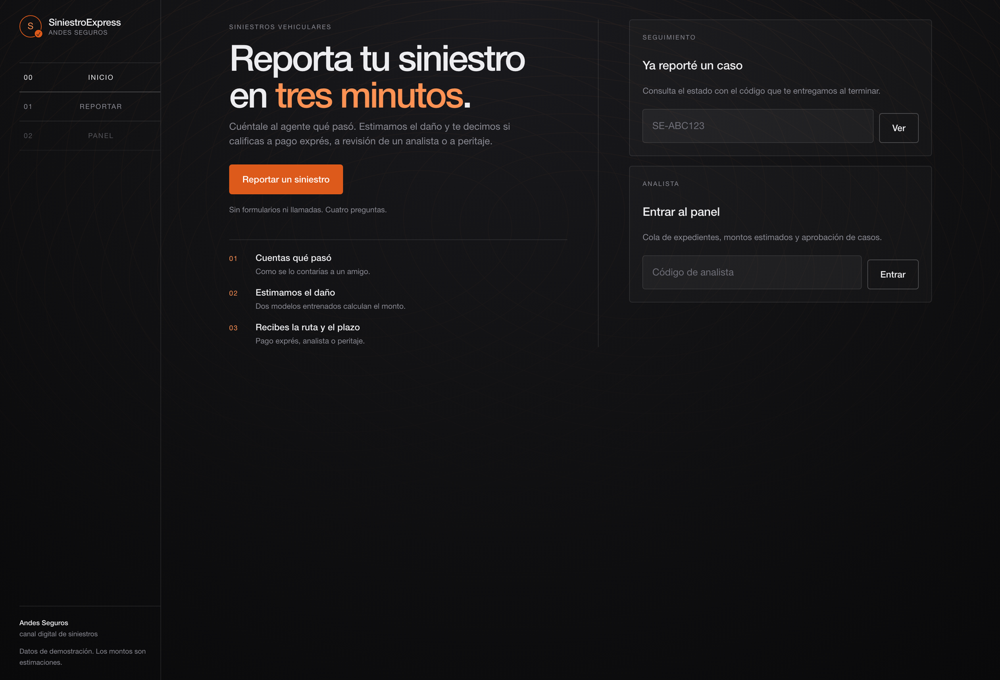
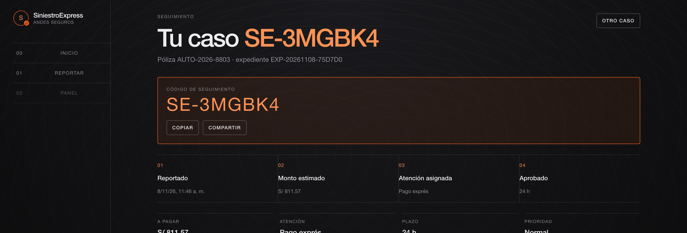
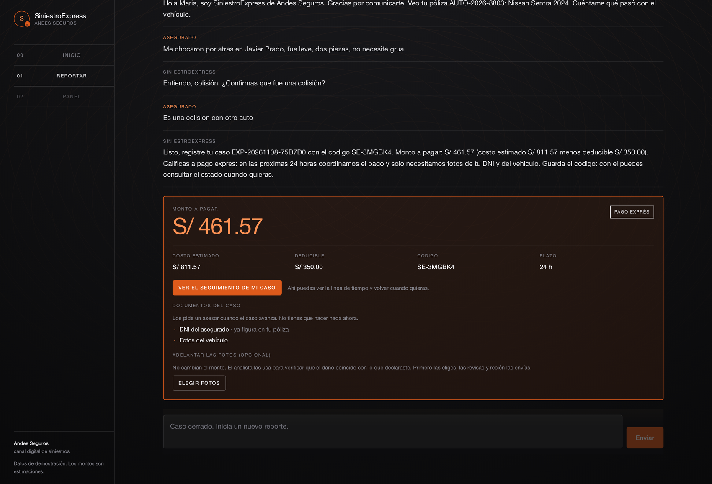
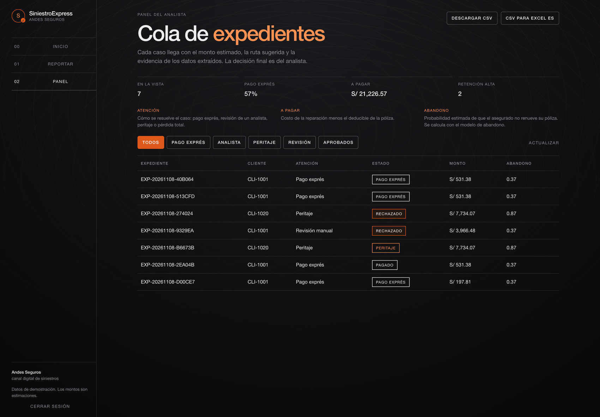
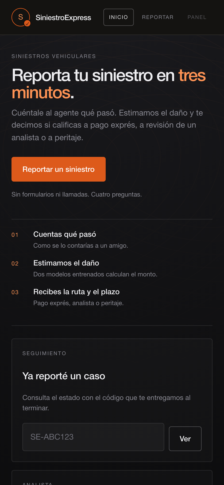
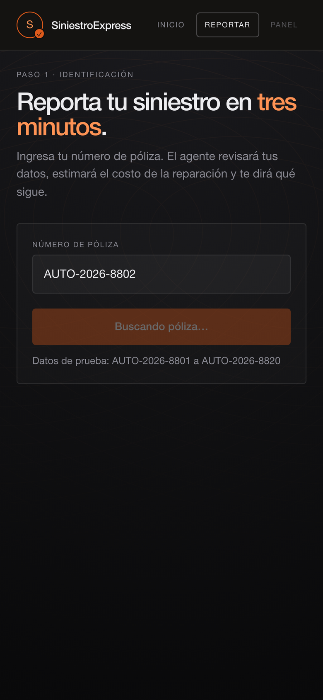
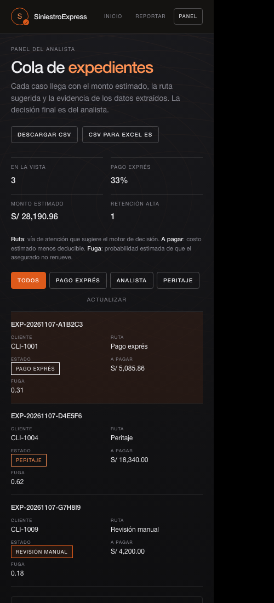

# Capturas de la interfaz

Capturas del build de producción contra la API real. Escritorio a 1440 px y móvil a
390 px, con un viewport de verdad: la ventana de Chrome no baja de 500 px por línea de
comandos, así que la versión móvil se tomó dentro de un iframe de 390.

## Escritorio

### Inicio

Una acción principal (reportar), y dos accesos secundarios: consultar un caso con el
código de seguimiento, o entrar al panel del analista con su código.

### Seguimiento del caso

Con el código `SE-XXXXXX` el asegurado ve la línea de tiempo, el monto, la atención
asignada, las fotos que envió y la conversación completa que quedó registrada en
DynamoDB.

### El veredicto

El asegurado ve lo que va a cobrar, no el costo de reparación. Desde aquí puede ir al
seguimiento del caso, y las fotos se eligen, se revisan y recién después se envían.

### Panel del analista

Resumen de la cola, filtros por estado, detalle con la evidencia de los slots
extraídos y acciones de aprobación o rechazo.

## Móvil

| Inicio | Chat | Panel |
|---|---|---|
|  |  |  |

En móvil la cabecera se reduce a la marca y tres palabras, la cola de expedientes pasa
de tabla a tarjetas con etiqueta por campo, y el compositor del chat queda pegado al
borde inferior.
